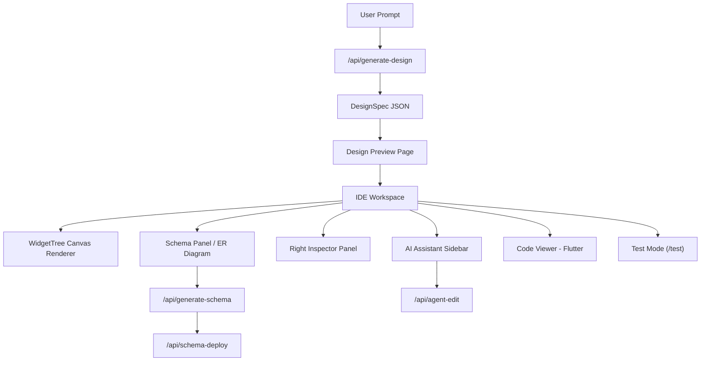

# Wiraflow — Complete Platform Documentation

> **AI-Powered App Design & Development Platform**
> Generate production-quality mobile app designs from natural language prompts, preview them in a real device frame, refine with an AI assistant, wire to a Supabase backend, export Flutter code, and test interactively — all from the browser.

---

## Table of Contents

1. [Overview & Architecture](#1-overview--architecture)
2. [Getting Started](#2-getting-started)
3. [Project Lifecycle](#3-project-lifecycle)
4. [Pages & Routes](#4-pages--routes)
5. [AI Design Generation Engine](#5-ai-design-generation-engine)
6. [Design Specification (DSL)](#6-design-specification-dsl)
7. [Widget Catalog](#7-widget-catalog)
8. [Canvas & Widget Renderer](#8-canvas--widget-renderer)
9. [Design Theme System](#9-design-theme-system)
10. [AI Assistant Sidebar](#10-ai-assistant-sidebar)
11. [Flutter Code Generation & Export](#11-flutter-code-generation--export)
12. [Database Schema Pipeline](#12-database-schema-pipeline)
13. [Interactive Test Mode](#13-interactive-test-mode)
14. [Component Reference](#14-component-reference)
15. [API Reference](#15-api-reference)
16. [Data Model & Types](#16-data-model--types)
17. [Configuration & Environment](#17-configuration--environment)
18. [Tech Stack & Dependencies](#18-tech-stack--dependencies)

---

## 1. Overview & Architecture

Wiraflow is a **browser-based IDE** that turns a text prompt into a fully designed, multi-page mobile application. The platform follows a linear pipeline:

```
Prompt → AI Generation → Design Preview → IDE Workspace → Backend Wiring → Test Mode → Flutter Export
```

### High-Level Architecture



### Core Data Flow

1. **User writes a prompt** on `/new-project`
2. **AI generates a `DesignSpec`** — JSON containing app name, palette, fonts, 7-8 pages with nested widgets
3. **`designSpecToUIGraph()`** converts the spec into a flat widget array + page index for the renderer
4. **`WidgetTree`** renders every widget as HTML/CSS that simulates Flutter widgets in a device frame
5. **User refines** via the AI Assistant, Right Inspector, or Theme Picker
6. **Schema generation** analyzes the design and creates Postgres DDL for Supabase
7. **Test Mode** provides interactive runtime with working navigation and form inputs
8. **Flutter Export** generates a complete Dart project as a downloadable ZIP

---

## 2. Getting Started

### Prerequisites
- Node.js 18+
- A Gemini API key (free from [aistudio.google.com/apikey](https://aistudio.google.com/apikey)) or OpenAI key

### Installation

```bash
cd wiraflow/apps/web
npm install
npm run dev
```

The app runs at `http://localhost:3000`.

### First-Time Setup

1. Navigate to **Settings** (`/settings`)
2. Enter your **Gemini API key** (starts with `AIza...`) or OpenAI key (`sk-...`)
3. Choose a model (default: `gemini-2.0-flash`)
4. Click **Save Settings** → **Test Connection**
5. Return to Home and click **New Project**

---

## 3. Project Lifecycle

Every project progresses through stages tracked by `ProjectStage`:

| Stage | Description |
|-------|-------------|
| `draft` | Created but no design generated yet |
| `designing` | AI generation in progress |
| `previewing` | Design generated, user reviewing in preview |
| `wired` | Backend schema generated and deployed |
| `deployed` | App fully configured and tested |

### Storage

All project data is persisted in **localStorage** via the `StoreProvider` context (`src/lib/store.tsx`). The store holds:
- `apiKey` — AI provider key
- `model` — Model name (e.g., `gemini-2.0-flash`)
- `projects[]` — Array of `Project` objects with full `DesignSpec` embedded

---

## 4. Pages & Routes

| Route | File | Purpose |
|-------|------|---------|
| `/` | `app/page.tsx` | Home — project grid, stats, "New Project" CTA |
| `/new-project` | `app/new-project/page.tsx` | Prompt input with example chips, loading animation |
| `/design-preview/[id]` | `app/design-preview/[sessionId]/page.tsx` | Full-screen design preview with approve/reject |
| `/project?id=xxx` | `app/project/page.tsx` | **Main IDE workspace** — canvas, sidebars, inspector |
| `/test?id=xxx` | `app/test/page.tsx` | Interactive Test Mode runtime |
| `/settings` | `app/settings/page.tsx` | API key, model, danger zone |
| `/transition-preview` | `app/transition-preview/page.tsx` | Motion/animation preview |

### API Routes

| Endpoint | Method | Purpose |
|----------|--------|---------|
| `/api/generate-design` | POST | AI design generation from prompt |
| `/api/edit-design` | POST | AI-powered design modifications |
| `/api/agent-edit` | POST | AI Assistant sidebar conversations |
| `/api/generate-schema` | POST | AI-powered Postgres schema from design |
| `/api/schema-deploy` | POST | Execute DDL migrations on Supabase |
| `/api/schema-fetch` | POST | Read existing schema from Supabase |

---

## 5. AI Design Generation Engine

### System Prompt (`/api/generate-design/route.ts`)

The system prompt defines Wiraflow as a "world-class Flutter Expert, UI/UX Master, and Enterprise Architect." It enforces:

- **Output format**: Raw JSON matching the `DesignSpec` schema
- **DSL property wrappers**: Every property must use typed wrappers (`stringVal`, `numberVal`, `boolVal`, `color`, `edgeInsets`, `radius`, `border`, `align`, `icon`, `px`, `textStyle`)
- **7-8 unique pages** per app with distinct layouts
- **Dark theme only** with vibrant accent colors
- **20+ widget types** from the full catalog
- **15-25 widgets per page** with realistic content
- **Typography scale**: 10 named styles from `headline_large` (32px) to `label_small` (10px)

### Generation Config

| Parameter | Value | Reason |
|-----------|-------|--------|
| `temperature` | 0.35 | Consistent, high-quality output |
| `maxOutputTokens` | 32,000 | Enough for 7-8 rich pages |

### Provider Detection

The API auto-detects the provider from the key format:
- `AIza...` → Gemini REST API
- `sk-...` → OpenAI Chat Completions API

### Post-Processing

The `designSpecToUIGraph()` function in `openai.ts` converts the AI output:
1. Normalizes widget types via `canonicalWidgetType()` (50+ aliases)
2. Converts DSL property wrappers to the internal format
3. Builds a flat widget array with parent-child relationships
4. Constructs page index with widget key lists

---

## 6. Design Specification (DSL)

The `DesignSpec` is the central data structure. Every AI-generated design produces one.

### Structure

```typescript
interface DesignSpec {
  appName: string;           // "FitTrack Pro"
  tagline: string;           // "Your fitness journey, simplified"
  palette: DesignPalette;    // 13 color tokens
  fonts: DesignFonts;        // { heading: "Inter", body: "DM Sans" }
  pages: DesignPageSpec[];   // 7-8 pages
  generatedAt: string;       // ISO timestamp
  model: string;             // "gemini-2.0-flash"
}
```

### Color Palette Tokens

| Token | Purpose | Example |
|-------|---------|---------|
| `primary` | Brand / CTA color | `#8B5CF6` |
| `onPrimary` | Text on primary | `#000000` |
| `secondary` | Secondary surfaces | `#0B1020` |
| `accent` | Vibrant highlight | `#22D3EE` |
| `background` | App background | `#000000` |
| `surface` | Card backgrounds | `#121212` |
| `surfaceElevated` | Elevated cards | `#1A1A1A` |
| `textPrimary` | Main text | `#F5F5F7` |
| `textSecondary` | Secondary text | `#A1A1A6` |
| `textMuted` | Hint/meta text | `#555555` |
| `divider` | Borders/lines | `#222222` |
| `error` | Error states | `#F87171` |
| `success` | Success states | `#4ADE80` |

### DSL Property Wrappers

Every widget property uses typed wrappers to ensure consistent parsing:

```json
{
  "content": { "stringVal": { "value": "Hello World" } },
  "size": { "numberVal": { "value": 24 } },
  "visible": { "boolVal": { "value": true } },
  "bg": { "color": { "color": "primary" } },
  "padding": { "edgeInsets": { "top": 0, "right": 0, "bottom": 0, "left": 0, "token": "lg" } },
  "radius": { "radius": { "topLeft": 16, "topRight": 16, "bottomLeft": 16, "bottomRight": 16 } },
  "border": { "border": { "width": 1, "color": "divider" } },
  "align": { "align": { "named": "center" } },
  "name": { "icon": { "name": "home_rounded" } },
  "width": { "px": { "value": 64, "isInfinity": false } },
  "style": { "textStyle": { "styleName": "headline_large" } }
}
```

### Spacing Tokens

| Token | Value |
|-------|-------|
| `xs` | 4px |
| `sm` | 8px |
| `md` | 16px |
| `lg` | 24px |
| `xl` | 32px |

---

## 7. Widget Catalog

### Layout Widgets

| Widget | Properties | Rendering |
|--------|-----------|-----------|
| `Scaffold` | `bg`, `safe_area` | Root page container with safe area inset |
| `Column` | `spacing`, `padding`, `cross_align`, `main_align`, `scroll` | Vertical flex container |
| `Row` | `spacing`, `align`, `cross_align`, `padding` | Horizontal flex container |
| `Container` | `bg`, `radius`, `padding`, `border`, `shadow`, `width`, `height`, `gradient` | Generic styled box |
| `Card` | Same as Container | Alias for Container |
| `Stack` | `fit` | Position: relative container with absolute children |
| `Expanded` | — | Flex: 1 fill container |
| `Center` | — | Flex center alignment |
| `SizedBox` | `width`, `height` | Fixed-size spacer |
| `Divider` | `color` | 1px horizontal line |
| `GridView` | `columns`, `spacing`, `cross_spacing` | CSS Grid layout |
| `Wrap` | `spacing`, `run_spacing` | Flexbox wrap for chips/tags |
| `ListView` | `scrollDirection`, `spacing`, `padding` | Scrollable list |

### Content Widgets

| Widget | Properties | Rendering |
|--------|-----------|-----------|
| `Text` | `content`, `style`, `color`, `font_weight`, `text_align`, `opacity` | Typography with auto contrast |
| `Icon` | `name`, `size`, `color` | Lucide icon mapped from Material names |
| `Image` | `source_desc`, `alt`, `fit`, `height`, `radius` | Image or gradient placeholder |
| `Avatar` / `CircleAvatar` | `size`, `bg`, `initials`, `border`, `icon` | Circular profile avatar |
| `Badge` | `content`, `bg`, `fg` | Small notification badge |

### Input Widgets

| Widget | Properties | Rendering |
|--------|-----------|-----------|
| `TextField` | `label`, `hint`, `icon`, `is_password` | Styled input with prefix icon |
| `Button` | `content`, `variant`, `size`, `full_width`, `icon_end` | Primary/ghost/outlined button |
| `SocialButton` | `icon`, `label` | Google/Apple/GitHub auth button |
| `IconButton` | `name`, `size`, `color`, `bg`, `radius`, `border` | Circular icon button |
| `Switch` | `label`, `value`, `color` | Toggle pill with sliding dot |
| `Slider` | `label`, `min`, `max`, `value`, `color` | Range slider with thumb |
| `Dropdown` | `label`, `hint`, `items`, `icon` | Select-like dropdown |
| `Chip` | `content`, `selected`, `variant` | Choice/input chip |

### Data Display Widgets

| Widget | Properties | Rendering |
|--------|-----------|-----------|
| `Chart` | `chart_type`, `title`, `height`, `color`, `data`, `show_grid` | SVG bar/line/pie chart |
| `Progress` | `variant`, `size`, `color` | Linear or circular progress |
| `RatingBar` | `value`, `max`, `size`, `color` | Star rating display |

### Composite Widgets

| Widget | Properties | Rendering |
|--------|-----------|-----------|
| `Carousel` | `height`, `auto_play`, `item_count` | Horizontal snap-scroll strip |
| `ListTile` | `title`, `subtitle`, `leading_icon`, `trailing_icon`, `trailing_text` | Standard list item |
| `BottomNavigationBar` | `bg`, `items` (jsonVal array) | Bottom tab bar |
| `AppBar` | `bg`, `fg`, `height` | Top app bar |
| `FAB` | `icon`, `bg`, `size` | Floating action button |
| `BottomSheet` | `bg`, `radius`, `height` | Bottom sheet with handle |

---

## 8. Canvas & Widget Renderer

### WidgetTree Component (`components/canvas/WidgetTree.tsx`)

The core rendering engine. It takes the flat widget array and page index, builds a tree structure, and recursively renders each widget as HTML/CSS.

**Key features:**
- **Device frame simulation**: iPhone 16 Pro Max and standard frames with bezel/clean skins, Dynamic Island, glass shine effect
- **Device presets**: iPhone SE, iPhone 15, iPhone 16 Pro Max, iPad Mini, custom sizes
- **Zoom controls**: Fit-to-window, 1:1, manual zoom (25%-200%), pan with Space+drag
- **Auto-contrast text**: Calculates contrast ratio against ancestor backgrounds and picks the best foreground color
- **Icon mapping**: `getLucideIconName()` converts Material Design icon names to Lucide equivalents (100+ mappings)
- **Theme-aware colors**: `resolveColor()` resolves palette tokens to actual hex values
- **Gradient support**: Linear and radial gradients on containers

### Rendering Pipeline

```
DesignSpec → designSpecToUIGraph() → { pages[], widgets[] }
                                          ↓
                                    WidgetTree component
                                          ↓
                                    buildTree() → TreeNode[]
                                          ↓
                                    renderComponent(node) → JSX
                                          ↓
                              switch(widget.flutterWidgetType)
                                    ↓        ↓        ↓
                               Scaffold  Column   Button  ...etc
```

### Style Resolution

Each widget's style is built from properties:
- `bg` → `backgroundColor`
- `padding` → `padding` (from token or explicit LTRB)
- `radius` → `borderRadius`
- `border` → `border`
- `shadow` → `boxShadow` (sm/md/lg/xl presets)
- `gradient` → `background: linear-gradient(...)` or `radial-gradient(...)`
- `width/height` → explicit dimensions or `100%`
- `spacing` → `gap` between children

---

## 9. Design Theme System

### Theme Picker (`components/theme/ThemePicker.tsx`)

9 curated design themes with dark and light variants:

| Theme | Accent | Heading Font | Description |
|-------|--------|-------------|-------------|
| Midnight Neon | Cyan `#22D3EE` | Space Grotesk | Cyber-dark with electric cyan |
| Aurora | Lime `#A3E635` | Outfit | Deep graphite with lime pop |
| Carbon | Blue `#3B82F6` | Sora | Minimal monochrome with cobalt |
| Sakura | Rose `#FB7185` | Poppins | Elegant rose + charcoal |
| Ocean | Teal `#2DD4BF` | Manrope | Professional teal/indigo |
| Royal Violet | Purple `#7C3AED` | Sora | Luxury violet with sapphire |
| Emerald Pro | Green `#10B981` | Manrope | Enterprise emerald + graphite |
| Sunset Slate | Orange `#FB923C` | Outfit | Warm coral on modern slate |
| Cobalt Ice | Blue `#2563EB` | Space Grotesk | Crisp cobalt for analytics |

### Theme Application

`applyDesignThemeToSpec()` in `designThemes.ts`:
1. Builds a hex→token map from the current palette
2. Tokenizes all hex color references in widget properties back to token names
3. Swaps the palette and fonts
4. Returns a new `DesignSpec` with the theme applied

### Google Fonts

`ensureGoogleFontsLoaded()` in `googleFonts.ts` dynamically injects `<link>` tags for Google Fonts with weights 200-900.

---

## 10. AI Assistant Sidebar

### Component: `AIAssistantSidebar.tsx`

A conversational AI agent embedded in the IDE that can modify the design based on natural language instructions.

**Features:**
- Chat interface with message history (persisted per project)
- Sends the current `DesignSpec` as context to the AI
- AI returns modified widget properties or new widgets
- Changes are applied immediately to the canvas
- Supports commands like: "Make the header bigger", "Change the accent color to blue", "Add a search bar to the home page"

**API**: `/api/agent-edit` — Receives chat messages + current design spec, returns modified spec

---

## 11. Flutter Code Generation & Export

### Code Viewer (`CodeViewer.tsx`)

Shows the Flutter/Dart equivalent of the current page in real-time. Uses `generateFlutterPageDart()` from `flutter-codegen.ts`.

### Code Generation (`flutter-codegen.ts`)

Converts `DesignSpec` → valid Flutter/Dart code:
- Maps each widget type to its Flutter equivalent (`Container` → `Container()`, `Column` → `Column()`, etc.)
- Resolves color tokens to `Color(0xFF...)` hex values
- Generates `EdgeInsets`, `BorderRadius`, `BoxDecoration`, `TextStyle`
- Handles `Button` variants → `ElevatedButton`, `OutlinedButton`, `TextButton`
- Generates `Chart` widgets using `fl_chart` package
- Produces proper widget nesting with `child`/`children`

### Project Export (`flutter-project-export.ts`)

Generates a complete Flutter project structure:

```
lib/
  main.dart          — App entry, MaterialApp with routes
  pages/
    page_login.dart  — Each page as a StatelessWidget
    page_home.dart
    ...
pubspec.yaml         — Dependencies (flutter, fl_chart if needed)
README.md            — Quick start instructions
```

### ZIP Download (`zip.ts`)

Bundles all generated files into a downloadable ZIP archive.

---

## 12. Database Schema Pipeline

### Schema Generation (`/api/generate-schema`)

AI analyzes the `DesignSpec` and generates:
- `SchemaPlanTable[]` — Tables with columns, types, constraints
- `MigrationStep[]` — Ordered DDL SQL statements
- `enums[]` — PostgreSQL ENUM types
- `rlsPolicies[]` — Row-Level Security policies

### Schema Panel (`SchemaPanel.tsx`)

UI for reviewing and deploying the generated schema:
- Table list with column details
- Migration step preview with SQL
- One-click deploy to Supabase
- ER Diagram visualization (`ERDiagram.tsx`)

### Schema Deploy (`/api/schema-deploy`)

Executes migrations directly against Supabase via PostgreSQL:
- Uses the `postgres` npm package for direct SQL connections
- Executes each `upSql` step independently
- Reports per-step success/failure

### Wiring Graph (`WiringGraph.tsx`)

Visual representation of UI → Database relationships showing which widgets are bound to which tables/columns.

---

## 13. Interactive Test Mode

### Route: `/test?id=<projectId>`

A standalone interactive runtime that renders the generated app with full interactivity.

### Runtime Engine (`runtime-engine.ts`)

Immutable state management with pure functions:

```typescript
interface RuntimeState {
  currentPageKey: string;
  navigationHistory: string[];
  formState: Record<string, Record<string, string>>;
  toasts: RuntimeToast[];
  events: RuntimeEvent[];
}
```

Functions: `navigate()`, `goBack()`, `setField()`, `addToast()`, `dismissToast()`, `addEvent()`, `clearEvents()`

### Action Resolver (`action-resolver.ts`)

Determines what happens when a widget is tapped:

| Detection | Action |
|-----------|--------|
| Explicit `widget.action.operation: "navigate"` | Navigate to target page |
| Label contains "Sign In" / "Login" | Auth → toast success → navigate to dashboard |
| Label contains "Sign Up" / "Create Account" | Auth → toast → navigate |
| Label contains "Get Started" / "Continue" | Navigate to next page |
| Label contains "Log Out" | Navigate to login page |
| Label contains "Save" / "Submit" / "Add to Cart" | Submit form → toast |
| `icon_end` contains arrow | Navigate to next page |
| `BottomNavigationBar` item tap | Navigate by `pageKey` or label match |

### Debug Console

Collapsible panel at the bottom showing real-time events:
- Navigation events (cyan)
- Action events (purple)
- Field change events (green)
- Form submit events (orange)
- Error events (red)

### Toast Notifications

Auto-dismissing (3s) glassmorphic toasts for success/error/info feedback.

---

## 14. Component Reference

### Canvas Components (`components/canvas/`)

| Component | File | Purpose |
|-----------|------|---------|
| `WidgetTree` | `WidgetTree.tsx` (2300+ lines) | Core widget renderer with device frame |
| `AIAssistantSidebar` | `AIAssistantSidebar.tsx` | Conversational AI design agent |
| `RightInspector` | `RightInspector.tsx` | Widget property editor |
| `LeftSidebar` | `LeftSidebar.tsx` | Widget tree navigator |
| `PagesStrip` | `PagesStrip.tsx` | Horizontal page tab bar |
| `PageBoard` | `PageBoard.tsx` | Multi-page overview board |
| `CodeViewer` | `CodeViewer.tsx` | Flutter code preview |
| `SchemaPanel` | `SchemaPanel.tsx` | Database schema management |
| `ERDiagram` | `ERDiagram.tsx` | Entity-relationship diagram |
| `WiringGraph` | `WiringGraph.tsx` | UI-to-database binding graph |
| `ProjectDatabaseConfig` | `ProjectDatabaseConfig.tsx` | Supabase connection config |
| `FlutterNativeRenderer` | `FlutterNativeRenderer.tsx` | Native Flutter rendering (experimental) |

### UI Components (`components/ui/`)

| Component | Purpose |
|-----------|---------|
| `GlassCard` | Glassmorphic card with blur effect |
| `Toast` | Global toast notification system |

### Layout Components (`components/layout/`)

| Component | Purpose |
|-----------|---------|
| `Sidebar` | Collapsible sidebar shell |
| `Inspector` | Inspector panel shell |

### Debug Components (`components/debug/`)

| Component | Purpose |
|-----------|---------|
| `DebugRail` | Event log rail in the IDE workspace |

### Theme Components (`components/theme/`)

| Component | Purpose |
|-----------|---------|
| `ThemePicker` | Design theme selector dropdown |

---

## 15. API Reference

### POST `/api/generate-design`

**Request:**
```json
{
  "prompt": "A fitness tracking app with workout logs",
  "apiKey": "AIza...",
  "model": "gemini-2.0-flash"
}
```

**Response:**
```json
{
  "success": true,
  "spec": { /* DesignSpec */ }
}
```

### POST `/api/agent-edit`

Sends chat context + current design for AI-powered modifications.

### POST `/api/edit-design`

Direct design editing via AI instructions.

### POST `/api/generate-schema`

**Request:** `{ designSpec, apiKey, model }`
**Response:** `{ success, schemaPlan: { tables, migrationSteps, enums, rlsPolicies } }`

### POST `/api/schema-deploy`

**Request:** `{ connectionString, migrationSteps }`
**Response:** `{ success, results: [{ step, success, error? }] }`

### POST `/api/schema-fetch`

**Request:** `{ connectionString }`
**Response:** `{ tables, schema }`

---

## 16. Data Model & Types

All types are defined in `src/lib/types.ts`:

```
DesignSpec
├── appName: string
├── tagline: string
├── palette: DesignPalette (13 color tokens)
├── fonts: DesignFonts { heading, body }
├── pages: DesignPageSpec[]
│   ├── key, name, purpose, pageType
│   └── widgets: DesignWidgetSpec[]
│       ├── key, parentKey, type, label
│       ├── semanticRole, interactive
│       ├── action?: { operation, targetPageKey, ... }
│       └── properties: Record<string, any> (DSL wrappers)
├── generatedAt: string
└── model: string

Project
├── id, name, description, stage
├── prompt, designSpec?, designThemeId?, designThemeMode?
├── pageCount, widgetCount
├── supabaseUrl?, supabaseAnonKey?, supabaseConnectionString?
├── schemaPlan?: SchemaPlan
├── agentGuidelines?, agentChatMessages?
└── promptLabGenerate?, promptLabEdit?

SchemaPlan
├── tables: SchemaPlanTable[] { columns, enableRls }
├── migrationSteps: MigrationStep[] { upSql, downSql }
├── enums: { name, values }[]
└── rlsPolicies: { tableName, operation, usingExpression }[]
```

### Page Types

`list` | `detail` | `form` | `dashboard` | `settings` | `profile` | `onboarding` | `explore` | `notifications` | `splash` | `activity` | `search`

### Semantic Roles

`layout_root` | `layout_column` | `layout_row` | `layout_container` | `text_heading` | `text_body` | `form_input` | `action_trigger` | `icon` | `component` | `navigation` | `data_display`

---

## 17. Configuration & Environment

### Environment Variables

| Variable | Purpose |
|----------|---------|
| `WIRAFLOW_BASIC_USER` | Basic Auth username (optional, for Cloudflare Tunnel) |
| `WIRAFLOW_BASIC_PASS` | Basic Auth password (optional) |

### Client-Side Storage

| Key | Content |
|-----|---------|
| `wiraflow-store` | JSON: `{ apiKey, model, projects[] }` |
| `wiraflow.ui.theme` | `"dark"` or `"light"` |
| `design-<projectId>` | sessionStorage: DesignSpec for preview handoff |

---

## 18. Tech Stack & Dependencies

| Technology | Version | Purpose |
|-----------|---------|---------|
| **Next.js** | 16.2.3 | Framework (App Router, API Routes) |
| **React** | 19.2.4 | UI library |
| **TypeScript** | 5.x | Type safety |
| **Lucide React** | 1.8.0 | Icon library (100+ icons used) |
| **Framer Motion** | 12.38.0 | Animations & transitions |
| **Supabase JS** | 2.104.1 | Client SDK for database |
| **Postgres** | 3.4.9 | Direct PostgreSQL connection for schema deploy |
| **Google GenAI (Genkit)** | 1.32.0 | Gemini AI integration |

### Build System

- **Turbopack** — Next.js bundler
- **CSS Modules** — Scoped styling (`.module.css`)
- **No TailwindCSS** — Pure vanilla CSS with CSS custom properties

### File Size Summary

| File | Lines | Purpose |
|------|-------|---------|
| `WidgetTree.tsx` | ~2,300 | Widget renderer (largest file) |
| `RightInspector.tsx` | ~2,000 | Property editor |
| `AIAssistantSidebar.tsx` | ~1,200 | AI chat agent |
| `route.ts` (generate-design) | ~200 | AI prompt + API handler |
| `openai.ts` | ~450 | Spec conversion + normalization |
| `flutter-codegen.ts` | ~740 | Dart code generation |
| `project/page.tsx` | ~830 | IDE workspace |
| `types.ts` | ~178 | All type definitions |

---

*Documentation generated for Wiraflow v0.1.0 — Last updated May 2026*
