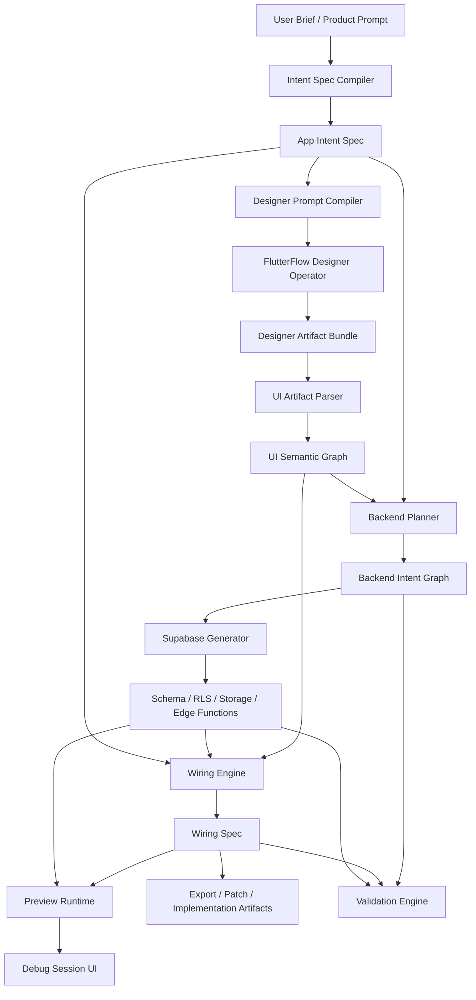

# Platform Builder Blueprint

## Revision Context

This revision updates the blueprint with the latest clarified decisions:

- the product is centered on **FlutterFlow Designer**, not the full FlutterFlow builder
- the platform must use its own **canonical App Intent Spec** as the source of truth
- FlutterFlow Designer is an external design-generation surface, not the system of record
- the platform's main value is **backend planning + wiring intelligence + live debug sessions**
- the internal OpenClaw agent system used to research and build this platform is **separate from the customer-facing product**

This document defines a separate product from Metrio:

- Metrio = one end-user app and reference use case
- Platform Builder = the system that can generate, infer, wire, preview, and explain working applications from design intent and backend intelligence

Metrio should still be used as an early reference app and test fixture, but the product itself must be designed as a standalone platform.

---

## Product Summary

The platform is not another generic "one prompt builds any app" product.

It is a specialized **app assembly and debugging platform** that:

1. turns product intent into a structured app plan
2. uses FlutterFlow Designer to generate frontend design artifacts
3. analyzes those artifacts into a machine-readable UI semantic graph
4. generates a production-oriented Supabase backend plan
5. creates schema, RLS, storage, edge functions, and other backend resources
6. generates the connection logic between UI and backend
7. runs the result in a preview/debug session where the user can see the screen, click it, and inspect what the system is doing

The platform wins if it can answer:

- what should this page load?
- what should this button do?
- what backend resources are required?
- what action chain should run here?
- why did this flow succeed or fail?

better, faster, and more transparently than manual setup or prompt-only builders.

---

## Core Thesis

Current AI builders are already good at pieces of the stack:

- design generation
- screen scaffolding
- component generation
- database scaffolding
- authentication setup

The missing layer is the one that is hardest to trust:

- mapping screen intent to backend entities
- inferring real data flows from design artifacts
- deciding which table, view, RPC, or edge function belongs to each widget
- generating correct action chains
- handling async jobs, uploads, and processing states
- making the system debuggable after generation

This platform's core value is:

**turning design intent into a working, inspectable, production-oriented application wiring system**

That means the product is not only about generation.
It is equally about:

- planning
- translation
- validation
- preview
- debugging
- explainability

---

## Product Positioning

This platform is not:

- a replacement for FlutterFlow Designer
- a replacement for Supabase
- a generic code generator for every frontend/backend stack
- a full visual builder replacement
- a pure prompt-to-app toy

This platform is:

**the intelligence and runtime layer between FlutterFlow Designer outputs and Supabase-backed application behavior**

The cleanest positioning statement is:

**"The platform that turns FlutterFlow Designer concepts into real, debuggable, production-ready app behavior."**

---

## Product Boundaries

### In Scope

- app intent capture and normalization
- Designer prompt compilation
- FlutterFlow Designer artifact ingestion
- UI semantic parsing
- backend planning for Supabase
- schema generation
- RLS planning and generation
- storage bucket planning
- edge-function planning and generation
- UI-to-backend wiring generation
- action-chain generation
- preview sessions
- debug sessions
- validation and explainability
- exportable specs and implementation artifacts

### Explicitly Out of Scope at MVP

- replacing FlutterFlow Designer itself
- replacing Supabase itself
- full arbitrary framework support
- fully autonomous production deploys without review
- complete collaborative IDE
- full visual editing inside this platform
- perfect round-trip design sync
- broad marketplace of third-party generators

---

## Product Architecture Principle

The most important design rule is:

**do not treat the Designer prompt as the source of truth**

The platform must own a canonical internal specification that survives:

- prompt drift
- design regeneration
- backend evolution
- partial approvals
- manual edits
- export/import cycles

That canonical specification is called:

**App Intent Spec**

---

## Canonical Source of Truth

### App Intent Spec

The App Intent Spec is the platform's first durable artifact.

It should capture:

- product name
- product description
- domain
- user roles
- app goals
- page catalog
- workflows
- domain entities
- asynchronous jobs
- file/media needs
- integration needs
- constraints
- non-goals

This artifact must exist before:

- Designer prompting
- backend generation
- wiring generation
- preview runtime generation

### Why This Matters

Without a canonical spec:

- the platform becomes dependent on whatever wording is pasted into Designer
- backend inference becomes unstable
- regeneration becomes dangerous
- debugging becomes opaque
- human approvals become inconsistent

The canonical spec is what allows the platform to say:

- "this design changed, but the app goal did not"
- "this backend plan conflicts with the intended workflow"
- "this action chain drifted from the original spec"

---

## Two Separate Systems

There are two systems to think about clearly.

### 1. Customer-Facing Product

This is the actual platform the end user will experience.

It handles:

- app intent
- design ingestion
- backend planning
- wiring generation
- preview and debugging

### 2. Internal Platform-Building Operating System

This is the OpenClaw-based internal system used by you to research, plan, and build the product itself.

It handles:

- market research
- architecture decisions
- product documentation
- implementation support
- review and critique

These two systems should not be confused.

The internal agent system helps build the platform.
It is not the same thing as the customer-facing runtime.

---

## End-to-End Product Flow

The intended customer-facing flow is:

1. User gives a product brief
2. Platform compiles it into an App Intent Spec
3. Platform generates a prompt optimized for FlutterFlow Designer
4. A Designer operator flow retrieves design artifacts
5. Platform parses those artifacts into a UI Semantic Graph
6. Platform builds a Backend Intent Graph
7. Platform generates Supabase resources
8. Platform generates Wiring Spec and action flows
9. Platform runs a Preview/Debug Session
10. User reviews, accepts, edits, or regenerates

---

## High-Level System Architecture



---

## Primary Stages

### Stage 1. Intent Capture

Purpose:

- convert a loose product description into a durable structured spec

Responsibilities:

- identify roles
- identify domain nouns
- identify core workflows
- identify app pages
- identify file or media requirements
- identify background jobs
- identify constraints and business logic

Outputs:

- App Intent Spec
- ambiguity list
- open assumptions

### Stage 2. Designer Prompt Compilation

Purpose:

- convert the App Intent Spec into a prompt optimized for FlutterFlow Designer

Responsibilities:

- describe page purposes clearly
- express visual hierarchy
- specify layout intentions
- preserve workflow semantics
- bias toward structurally useful screens, not vague visual fluff

Outputs:

- Designer prompt
- page-by-page generation instructions

### Stage 3. Designer Artifact Retrieval

Purpose:

- obtain usable frontend artifacts from FlutterFlow Designer

Likely techniques:

- browser/operator automation
- clipboard export retrieval
- saved prompt markdown retrieval
- frame/image exports
- any future official integration when available

Key rule:

- Designer is treated as an external generation tool
- the platform should ingest its artifacts, not surrender control to it

### Stage 4. UI Semantic Parsing

Purpose:

- convert raw Designer output into machine-readable frontend meaning

Responsibilities:

- detect pages
- detect containers and sections
- infer widget roles
- infer list/detail/form patterns
- infer primary and secondary actions
- infer route relationships

Outputs:

- UI Semantic Graph

### Stage 5. Backend Planning

Purpose:

- transform UI intent plus product intent into a production-oriented backend plan

Responsibilities:

- infer entities
- infer relationships
- define status/state lifecycles
- decide tables vs views
- plan auth model
- plan RLS expectations
- plan storage usage
- plan edge functions and async jobs

Outputs:

- Backend Intent Graph
- Schema Plan
- RLS Plan
- Storage Plan
- Edge Function Plan

### Stage 6. Wiring Generation

Purpose:

- connect frontend semantics to backend resources

Responsibilities:

- query inference
- mutation inference
- binding inference
- action-chain generation
- navigation parameter mapping
- loading/empty/error logic
- polling logic
- upload and processing flows

Outputs:

- Wiring Spec

### Stage 7. Preview and Debug

Purpose:

- render the app inside the platform and explain what is happening as the user interacts with it

Responsibilities:

- render pages
- execute action chains
- call real or simulated backend resources
- trace state changes
- trace queries and mutations
- surface logs, warnings, and assumptions

Outputs:

- Debug Session
- Event Log
- Trace Artifacts

---

## FlutterFlow Designer Integration Strategy

### Important Clarification

This platform is about **FlutterFlow Designer** first.

That means the immediate problem is not:

- importing mature builder metadata from a fully structured app builder

It is:

- working with a design-generation tool that returns design artifacts and export formats

### Current Integration Model

At present, the platform should assume:

- Designer is an external tool
- the operator flow may need browser automation
- the primary artifacts may be prompt markdown and design exports
- the platform must perform its own semantic interpretation afterward

### Practical Rule

Build the integration around:

1. prompt handoff
2. artifact retrieval
3. artifact parsing

Do not build the platform around:

- a hypothetical perfect Designer API
- a hypothetical stable Designer MCP
- hidden internal Designer state you cannot reliably access

### Optional Future Extension

If the flow later needs to continue into full FlutterFlow builder territory, that should be treated as a downstream optional adapter, not the core product identity.

---

## Supabase Strategy

Supabase is the platform's primary backend target because it provides:

- Postgres
- Auth
- Storage
- Realtime
- Edge Functions
- branching and environment workflows

The platform should use Supabase as the main backend substrate for:

- entity persistence
- row-level security
- file storage
- background processing
- real-time updates
- preview environments

The platform must still keep its own internal graphs and plans as the source of truth.

Supabase should be the execution layer, not the planning layer.

---

## Core Internal Artifacts

The platform should produce durable artifacts, not only transient runtime state.

### Primary Artifacts

- `AppIntentSpec`
- `DesignerArtifactBundle`
- `UISemanticGraph`
- `BackendIntentGraph`
- `SchemaPlan`
- `EdgeFunctionPlan`
- `WiringSpec`
- `PreviewSessionTrace`
- `ValidationReport`

### Suggested Artifact Locations

- `specs/app-intent-spec.json`
- `specs/ui-semantic-graph.json`
- `specs/backend-intent-graph.json`
- `specs/schema-plan.sql`
- `specs/wiring-spec.json`
- `specs/validation-report.json`
- `debug/session-trace.json`

---

## Internal Data Model

The product should maintain a normalized internal model.

### Project

- `id`
- `name`
- `description`
- `domain`
- `status`
- `created_at`
- `updated_at`

### AppIntentSpec

- `id`
- `project_id`
- `original_prompt`
- `app_goal`
- `roles`
- `entities`
- `page_catalog`
- `workflows`
- `async_jobs`
- `constraints`
- `non_goals`
- `assumptions`

### DesignArtifact

- `id`
- `project_id`
- `source`
- `artifact_type`
  - `designer_prompt_markdown`
  - `frame_export`
  - `image_export`
  - `clipboard_export`
  - `operator_capture`
- `content_ref`
- `created_at`

### Page

- `id`
- `project_id`
- `name`
- `route`
- `purpose`
- `source_design_ref`

### Widget

- `id`
- `page_id`
- `parent_widget_id`
- `type`
- `label`
- `semantic_role`
- `repeatable`
- `interactive`
- `source_ref`

### DomainEntity

- `id`
- `project_id`
- `name`
- `description`
- `lifecycle`
- `fields`
- `relationships`

### BackendResource

- `id`
- `project_id`
- `kind`
  - `table`
  - `view`
  - `rpc`
  - `edge_function`
  - `storage_bucket`
- `name`
- `schema`
- `metadata`

### PermissionAssumption

- `id`
- `project_id`
- `scope`
- `role`
- `resource_name`
- `operation`
- `assumption`

### QuerySpec

- `id`
- `page_id`
- `widget_id`
- `resource_id`
- `mode`
  - `single`
  - `list`
  - `count`
  - `search`
  - `aggregate`
- `filters`
- `sorting`
- `limit`
- `depends_on_state`
- `confidence`

### MutationSpec

- `id`
- `page_id`
- `widget_id`
- `resource_id`
- `operation`
  - `insert`
  - `update`
  - `delete`
  - `upsert`
  - `upload`
  - `call_function`
- `payload_mapping`
- `preconditions`
- `postconditions`
- `confidence`

### ActionSpec

- `id`
- `page_id`
- `widget_id`
- `action_type`
- `steps`
- `rollback_strategy`
- `error_strategy`
- `sequence_order`

### WorkflowSpec

- `id`
- `project_id`
- `name`
- `trigger`
- `states`
- `transitions`
- `retry_policy`

### StateVar

- `id`
- `page_id`
- `name`
- `type`
- `default_value`
- `scope`

### NavigationSpec

- `id`
- `from_page_id`
- `to_page_id`
- `trigger_widget_id`
- `params`

### BindingSpec

- `id`
- `widget_id`
- `binding_type`
  - `text`
  - `visibility`
  - `count`
  - `list_item`
  - `icon`
  - `badge`
  - `image`
  - `input_value`
- `source_expression`
- `confidence`

### Warning

- `id`
- `project_id`
- `severity`
  - `info`
  - `warning`
  - `critical`
- `category`
- `message`
- `recommended_action`

### PreviewSession

- `id`
- `project_id`
- `mode`
  - `design_preview`
  - `wired_preview`
  - `live_preview`
- `started_at`
- `ended_at`
- `status`

### EventLogEntry

- `id`
- `session_id`
- `timestamp`
- `event_type`
- `source`
- `payload`

---

## Core Graphs

### 1. UI Semantic Graph

This graph represents the meaning of the frontend.

It should capture:

- pages
- sections
- widgets
- route relationships
- visual hierarchy
- semantic roles
- likely data needs
- likely action triggers

### 2. Backend Intent Graph

This graph represents the intended backend structure implied by:

- app goals
- page semantics
- workflows
- domain relationships

It should capture:

- entities
- relationships
- auth boundaries
- status machines
- storage needs
- async jobs
- function boundaries

### 3. Wiring Graph

This graph represents how frontend semantics connect to backend execution.

It should capture:

- queries
- mutations
- bindings
- action chains
- page state
- navigation
- dependencies

These graphs must remain explicit and inspectable.
Without them, the platform becomes ad hoc and brittle.

---

## Inference Strategy

The platform should use:

**deterministic rules first, AI refinement second**

### Deterministic First

Deterministic systems should handle:

- known widget patterns
- known page patterns
- schema truth
- route parameter consistency
- exact column and table validation
- static mapping generation

### AI Second

AI should be used for:

- semantic inference
- ambiguous mapping resolution
- page-purpose inference
- workflow explanation
- confidence scoring
- fallback recommendations

### Critical Rule

AI must never be the only authority for:

- schema truth
- permissions
- exact identifiers
- safe mutations
- final validation

---

## Widget Heuristics

### Repeating Cards / Rows

Likely map to:

- list query
- search results
- related entities

Likely require:

- list item bindings
- row navigation
- optional filters

### Search Inputs

Likely map to:

- debounced filtering
- view-based search
- server-side search query

### Filter Chips / Tabs

Likely map to:

- enum filters
- category filters
- segment filters

### Primary CTA Buttons

Likely map to:

- create row
- submit form
- upload file
- process document
- call edge function
- continue workflow

### Detail Sections

Likely map to:

- single-row query
- related subqueries
- route param lookup

### Status Indicators

Likely map to:

- enum state
- derived state
- async process phase
- health score

---

## Page Heuristics

### Dashboard

Usually needs:

- aggregate counts
- summary cards
- recent items
- notifications or pending work

### List Page

Usually needs:

- paginated list query
- recency sort
- filters
- search

### Detail Page

Usually needs:

- query by id
- related resource loading
- secondary actions

### Form Page

Usually needs:

- field bindings
- validation rules
- create or update mutation
- success/error transitions

### Upload / Processing Page

Usually needs:

- storage upload
- database row creation
- edge function call
- polling or realtime subscription
- status updates

---

## Backend Planning Rules

The backend planner should infer more than tables.

It should infer:

- identity boundaries
- ownership models
- lifecycle status fields
- audit fields
- derived views
- RLS expectations
- storage bucket rules
- edge function triggers
- async orchestration

### Recommended Default Backend Patterns

- every important entity gets `id`, `created_at`, `updated_at`
- ownership-sensitive entities get `created_by` or `owner_id`
- asynchronous workflows get explicit status fields
- user-facing lists often prefer views over raw table joins
- uploads should generate both storage config and DB metadata mapping
- expensive or external workflows should go through edge functions

---

## Validation Layer

The platform should validate all generated artifacts before they are accepted.

### Validation Categories

#### Design Parsing Validation

- page count makes sense
- route graph is connected
- required widgets are identified

#### Backend Validation

- table exists
- column exists
- enum values exist
- storage buckets exist
- edge function inputs match expected contract

#### Wiring Validation

- query references are valid
- action outputs feed later steps correctly
- route params exist
- bindings reference valid fields
- loading and error states are reachable

#### Permission Validation

- role assumptions are explicit
- ownership assumptions are explicit
- potentially unsafe mutations are flagged

#### Preview Validation

- preview runtime can execute declared action chain
- trace events align to spec
- retries and failures surface correctly

If validation fails, the platform must produce warnings or hard stops instead of silently shipping bad wiring.

---

## Output Contracts

The product should output structured artifacts that are easy to:

- review
- diff
- edit
- regenerate
- render into adapters

### Example App Intent Spec

```json
{
  "app_name": "Metrio",
  "goal": "Analyze uploaded meeting audio and surface transcripts, attendees, action items, and summaries.",
  "roles": ["admin", "member"],
  "entities": [
    "meetings",
    "transcript_segments",
    "meeting_attendees",
    "action_items"
  ],
  "pages": [
    "MeetingsList",
    "MeetingDetail",
    "UploadMeeting",
    "AnalysisDashboard"
  ],
  "async_jobs": [
    "process-meeting-audio"
  ]
}
```

### Example Wiring Spec

```json
{
  "page": "MeetingDetail",
  "queries": [
    {
      "name": "meeting",
      "source": "public.meetings",
      "mode": "single",
      "filters": [
        { "field": "id", "op": "eq", "value": "$route.meeting_id" }
      ]
    },
    {
      "name": "transcript_segments",
      "source": "public.transcript_segments",
      "mode": "list",
      "filters": [
        { "field": "meeting_id", "op": "eq", "value": "$route.meeting_id" }
      ],
      "sort": [
        { "field": "sequence_order", "direction": "asc" }
      ]
    }
  ],
  "actions": [
    {
      "widget": "AnalyzeMeetingButton",
      "steps": [
        "call_edge_function(process-meeting-audio)",
        "set_variable(processingStatus, processing)",
        "poll_query(meeting.status)",
        "refresh_query(transcript_segments)"
      ]
    }
  ]
}
```

### Example Debug Event

```json
{
  "session_id": "dbg_001",
  "timestamp": "2026-04-01T18:00:00Z",
  "event_type": "action_step_completed",
  "source": "AnalyzeMeetingButton",
  "payload": {
    "step": "call_edge_function(process-meeting-audio)",
    "status": "success",
    "response_code": 202
  }
}
```

---

## Preview and Debug Experience

This is one of the most important differentiators.

The platform should not only generate the app.
It should let users **see and inspect the app while it runs**.

### Preview Modes

#### 1. Design Preview

Purpose:

- fast visual inspection

Characteristics:

- no real backend
- layout-focused
- good for quick sanity checks

#### 2. Wired Preview

Purpose:

- test generated queries, bindings, and actions against mocked or staged data

Characteristics:

- partial execution
- useful before hitting live backend resources

#### 3. Live Preview

Purpose:

- execute the generated app behavior against a real preview Supabase environment

Characteristics:

- real queries
- real mutations
- real uploads
- real edge function calls
- high debugging value

### Session UI Layout

- left panel = page tree, route graph, entity graph
- center panel = live app screen
- right panel = selected widget inspector
- bottom panel = event log and trace stream

### Inspector Should Show

- selected widget semantics
- bound query or mutation
- action chain
- visibility rules
- state dependencies
- confidence level
- warnings

### Event Log Should Show

- query started
- query completed
- query failed
- mutation started
- mutation completed
- storage upload started
- storage upload completed
- edge function called
- edge function response received
- navigation triggered
- variable changed
- polling tick
- retry event

### Example Debug Flow

When a user clicks `Analyze` on a meeting page, the log should read something like:

- `upload_file -> success`
- `create_row(meetings) -> success`
- `call_edge_function(process-meeting-audio) -> accepted`
- `poll meetings.status -> processing`
- `poll meetings.status -> completed`
- `refresh transcript_segments -> 42 rows`

This is the level of explainability the platform should provide.

---

## Explainability Requirements

Every generated decision should be explainable.

The platform should be able to answer:

- why this table was selected
- why this page was treated as a list page
- why this button triggers an edge function
- why this query filters by a specific route param
- why this mutation requires ownership assumptions

That means every inference should carry:

- reasoning summary
- confidence
- warnings
- upstream evidence

---

## Product Differentiators

Potential moat areas:

1. strong backend planning from UI intent
2. high-quality wiring for Designer-driven apps
3. upload/process/async flow generation
4. preview and debug visibility
5. regeneration with safety and explainability

The platform wins if teams can go from:

- vague app brief
- generated design artifacts

to:

- working backend plan
- correct action flows
- inspectable live preview

without spending days manually wiring everything.

---

## Risks and Mitigations

### Risk 1. Designer Artifact Instability

Problem:

- Designer outputs may not always be equally structured

Mitigation:

- build resilient artifact parsers
- use multiple artifact forms
- keep canonical App Intent Spec outside Designer

### Risk 2. Backend Over-Inference

Problem:

- the system may infer too much and create incorrect backend structures

Mitigation:

- human review gates
- confidence thresholds
- validation reports
- approval before resource creation

### Risk 3. Preview Divergence

Problem:

- preview runtime may differ from eventual deployed behavior

Mitigation:

- keep runtime contracts explicit
- test against live preview environments
- log spec-to-runtime mismatches

### Risk 4. Tool Dependency

Problem:

- product depends on FlutterFlow Designer and Supabase behaviors

Mitigation:

- create adapter boundaries
- keep internal graphs vendor-neutral where possible
- avoid over-coupling to hidden vendor internals

### Risk 5. Premature Full Automation

Problem:

- attempting to automate every step too early will create fragile systems

Mitigation:

- start with artifact-driven reviewable outputs
- automate only after contracts are stable

---

## MVP Definition

The MVP should be intentionally narrow.

### MVP Goal

Build a platform that can take:

- an App Intent Spec
- a FlutterFlow Designer artifact bundle for one to three pages
- a Supabase schema snapshot or connected preview project

and produce:

- backend plan
- schema and resource recommendations
- wiring spec
- action chains
- preview/debug session for those pages

### Recommended MVP Scope

Supported page types:

1. list page
2. detail page
3. form page
4. upload/process page

Supported action types:

1. create row
2. update row
3. upload file
4. call edge function
5. navigate with params
6. poll status

### MVP Non-Goals

- perfect design fidelity
- full app generation across all pages
- broad vendor support
- autonomous deployment

---

## Recommended Build Phases

### Phase 0. De-Risking

Deliver:

- verified Designer artifact retrieval workflow
- canonical App Intent Spec schema
- UI Semantic Graph schema
- Backend Intent Graph schema

This phase proves:

- the product is buildable on real artifacts

### Phase 1. Internal Analysis Tool

Deliver:

- CLI or simple internal web tool
- artifact ingestion
- semantic parsing
- backend plan generation

This phase proves:

- the core intelligence is useful before automation

### Phase 2. Wiring Spec Generator

Deliver:

- structured Wiring Spec
- action-chain generation
- binding generation
- warnings and confidence scores

This phase proves:

- repeatable mapping quality

### Phase 3. Preview Runtime

Deliver:

- wired preview renderer
- debug event log
- state inspector

This phase proves:

- users can actually interact with generated flows

### Phase 4. Live Preview

Deliver:

- real Supabase preview execution
- storage upload flows
- edge function invocation
- validation reports

This phase proves:

- real operational value

### Phase 5. Automation Layer

Deliver:

- Designer operator automation
- export pipelines
- regeneration workflows

This phase proves:

- the platform can save meaningful time end to end

### Phase 6. Productized Platform

Deliver:

- project UI
- versioning
- diff/review
- approval gates
- team workflows

---

## Technical Stack Recommendation

### Platform Frontend

- React / Next.js
- project explorer
- app canvas / preview runtime
- inspector panels
- debug session UI

### Platform Backend

- Supabase or Postgres
- job queue for artifact analysis and generation
- persistent artifact store
- session and event log store

### Generation Layer

- TypeScript
- schema parsers
- artifact parsers
- graph builders
- rules engine
- validation engine

### Integrations

- FlutterFlow Designer operator flow
- Supabase project access
- optional future builder/export adapters

---

## Suggested Repository Structure

```text
platform-builder/
  apps/
    web/
    worker/
  packages/
    app-intent-spec/
    ui-semantic-graph/
    backend-intent-graph/
    designer-adapter/
    artifact-parser/
    backend-planner/
    supabase-generator/
    wiring-engine/
    preview-runtime/
    debug-session/
    validation/
  docs/
    architecture.md
    app-intent-spec.md
    ui-semantic-graph.md
    backend-intent-graph.md
    wiring-spec.md
    debug-session.md
  examples/
    metrio-like/
```

---

## Immediate Product Deliverables

The first essential deliverables should be:

1. App Intent Spec schema
2. Designer artifact bundle contract
3. UI Semantic Graph schema
4. Backend Intent Graph schema
5. Wiring Spec schema
6. Validation report schema

If these are solid, the platform becomes real.
If they are weak, later automation will only make the system more fragile.

---

## Internal Development Operating Model

This section is about how the platform should be researched and built internally.
It is not the customer-facing architecture.

### OpenClaw Workspace

The internal project workspace should be a dedicated OpenClaw workspace with:

- docs
- research
- decisions
- specs
- skills
- memory

### Development Principle

Use AI agents as a **small operating team**, not a noisy swarm.

### Recommended Starter Roster

#### Studio

Purpose:

- lead agent
- final synthesis
- roadmap and architecture decisions

Model strategy:

- strong model

#### Researcher

Purpose:

- cheap first-pass research
- summarization
- clustering
- extraction from local and approved materials

Model strategy:

- local Llama 3 for cost control

#### Builder

Purpose:

- implementation planning
- schema/spec writing
- code execution on the platform itself

Model strategy:

- stronger model for difficult engineering work

#### Reviewer

Purpose:

- challenge assumptions
- review specs
- catch over-scope and fragility

Model strategy:

- local first, stronger model on demand

### Recommended Agent Communication Model

Do not let all agents talk freely.

Use:

- shared workspace
- file-based artifacts
- explicit handoffs
- one lead coordinator

Preferred pattern:

`studio -> researcher -> builder -> reviewer -> studio`

### Cost Strategy

For minimal cost:

- use local models for drafting, summarization, clustering, and low-risk synthesis
- use stronger paid models only for final architecture, important design decisions, and difficult implementation
- keep subagent spawning limited
- keep contexts small
- favor structured artifacts over long chat history

### Subagent Policy

Subagents are not required at the beginning.

Use them only when:

- work can run in parallel
- ownership is clear
- artifacts are well defined

Do not use them:

- for every small task
- when one lead agent can do the work directly
- when the result is too tightly coupled to the immediate next step

---

## First 30-60 Day Execution Plan

### Track 1. Product Core

- define App Intent Spec
- define UI Semantic Graph
- define Backend Intent Graph
- define Wiring Spec
- build validation rules

### Track 2. Designer De-Risking

- prove reliable artifact retrieval
- document export bundle structure
- build artifact parser fixtures

### Track 3. Backend Intelligence

- generate schema plans
- generate storage plans
- generate edge-function plans
- validate RLS assumptions

### Track 4. Runtime and Debugging

- build preview runtime
- build event bus
- build inspector UI
- build trace viewer

### Track 5. Internal Operating System

- establish research templates
- establish ADR templates
- establish spec-writing skills
- establish cost-aware agent workflow

---

## Final Product Statement

This platform is not the next generic prompt-to-app generator.

It is:

**a design-to-backend assembly and debugging platform that transforms FlutterFlow Designer output and Supabase infrastructure into a working, explainable, production-oriented application system**

That is the clearest, strongest, and most realistic version of the idea.
