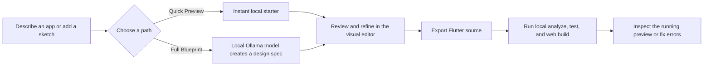
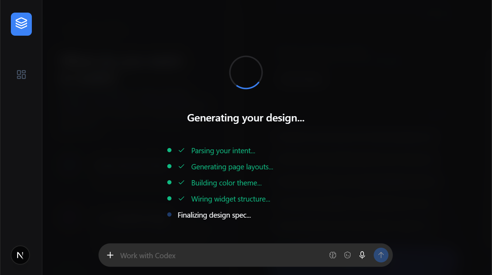

# WiraFlow — Project Brief, Competitive Position, and Roadmap

**Audience:** beginners, potential users, mentors, and early collaborators  
**Snapshot date:** 20 October 2026  
**Status:** working prototype; this document separates features visible in the code from the longer-term product vision.

## The one-minute explanation

WiraFlow is a local-first workshop for turning an app idea into a Flutter starting point. A person describes an app, reviews a generated screen blueprint in a visual editor, adjusts its theme, and can export Flutter source. On a computer with Ollama and Flutter installed, WiraFlow can also ask a local Gemma model to help design or edit the app and can run local Flutter checks.

The simple promise is: **start with an idea, see a screen, get code you can inspect, and check whether that code builds on your own computer.**

WiraFlow is currently a prototype and accelerator. It should not yet be presented as a replacement for a professional engineering team or as a one-click producer of production-ready apps.

## Why it is useful

People with an app idea often face a long gap between “I know what I want” and “I can see or run it.” They may need to learn Flutter, find a design tool, configure an AI account, create a project, and work through build errors before they can judge the idea. WiraFlow tries to shorten that first loop.

It is most useful for:

- **Beginners and students** who want to turn a small idea into an editable screen and learn from the generated Flutter files.
- **Indie developers and hackathon teams** who want a fast, inspectable starting point before investing in detailed implementation.
- **Designers and product people** who want to explore pages, colors, and app flows before a developer builds them.
- **Privacy-conscious teams** that prefer prompts and model inference to stay on a computer they control, subject to their own setup and network choices.
- **Low-connectivity environments** after the software, model, Flutter SDK, and required packages have already been installed or cached.

It is less suitable today for a team that needs a guaranteed production app, real-time collaboration, a hosted backend configured automatically, or a polished mobile app store release with no engineering review.

## How a beginner uses it

1. **Describe an app.** For example: “A student habit tracker with today’s checklist and a streak counter.”
2. **Choose a starting path.** Quick Preview creates a deterministic one-screen starter locally without waiting for a model. Full Blueprint asks the selected model for a richer, two-page design. An uploaded sketch uses the full local vision flow.
3. **Review the design.** WiraFlow renders the structured design in a device-style canvas. The user can move between pages, change the theme or palette, and request AI edits.
4. **Approve and continue.** The project workspace includes the canvas, widget inspector, AI edit panel, code view, and backend/schema tools.
5. **Export or check Flutter.** WiraFlow can generate a Flutter project ZIP. The local build panel can run package resolution, `flutter analyze`, `flutter test`, and `flutter build web`; if configured, Gemma can try to repair Dart errors before the preview is shown.

## What makes WiraFlow different

The strongest product distinction is **where the work can happen**. In Local Ollama mode, design and edit requests go to an Ollama service restricted to `localhost`; the app defaults to a Gemma 4 E2B tag. This avoids an AI-provider API key and per-request AI charges for that local inference path. Flutter build checks also run on the WiraFlow host. The user still supplies the computer, electricity, storage, and setup.

The second distinction is **a Flutter-oriented handoff with a local check loop**. WiraFlow does more than display a picture: it keeps a structured design specification, renders an editable preview, generates Dart project files, and has a local analyze/test/build flow. The build panel records first-pass and after-repair results on that browser profile, which can support a later honest benchmark.

The third is **an inspectable intermediate step**. The blueprint and widget tree sit between the prompt and the exported code. That gives a learner or developer something to review and correct rather than asking them to trust a wall of generated code.

These are meaningful product choices, but they are not exclusive features. Competitors also offer natural-language generation, editable screens, previews, code export, and AI-assisted iteration. WiraFlow’s defensible difference must be proven through a better local privacy story, reliable Flutter output, short repair cycles, transparent evaluation, and a smooth beginner experience—not through the claim that no other builder uses AI.

## Competitive landscape

The following is a product-level comparison, not a claim that WiraFlow wins every category. Competitor product pages change frequently; linked official pages are the source for the current descriptions.

| Product | What it is good at | Where WiraFlow can be distinct | What WiraFlow must catch up on |
|---|---|---|---|
| **FlutterFlow / FlutterFlow Designer** | The closest Flutter competitor: visual app building, prompt-and-image-based editable screen design, theme editing, and handoff into FlutterFlow. Its Designer can export screens to FlutterFlow, PNG, or an agent prompt. [Designer prompting](https://docs.flutterflow.io/designer/prompting/) · [Export options](https://docs.flutterflow.io/designer/export/) | Make local model inference and local Flutter verification the default story, with exportable source and no AI API key in the local path. | FlutterFlow is a mature visual builder with reusable components, integrations, and a direct design-to-builder handoff. WiraFlow is not yet at that breadth or maturity. |
| **Bolt.new** | Prompt-driven web and mobile app creation, a browser code editor, live preview, backend features, and deployment in one hosted workflow. [Bolt introduction](https://support.bolt.new/building/intro-bolt) · [Bolt Cloud](https://bolt.new/get-started) | Focus on native Flutter source and running model/build checks on the developer’s own computer. | Bolt offers a much smoother hosted setup and an integrated path to publish a web app. WiraFlow requires local software and hardware setup. |
| **Lovable** | Fast prompt-based web app creation, common React/Supabase workflows, and GitHub sync for continuing in a code repository. [Lovable](https://lovable.dev/meta-lp) | Be the choice when a user specifically wants a private/local workflow and a Flutter-first result. | Lovable is optimized for a different output and has strong hosted backend and collaboration workflows. WiraFlow’s backend and sharing experience are less complete. |
| **Replit Agent** | Creating, editing, testing, and deploying apps in a browser workspace with little local setup. [Replit AI overview](https://docs.replit.com/power-ups/replitai/replitai-chat) · [Agent testing](https://docs.replit.com/replitai/assistant/) | Offer local inference, local source/build access, and fewer dependencies on a hosted AI session. | Replit’s hosted environment, deployment, collaboration, and wide language support are more convenient for many new users. |

### A fair answer to “why choose WiraFlow?”

Choose WiraFlow if you specifically value keeping AI inference local, want Flutter files you can inspect, and are willing to trade setup effort and possibly slower generation for control. Choose a hosted competitor if you value the quickest setup, managed databases, collaboration, and one-click public deployment more than local execution.

## What the prototype does today—and what the slogan should not imply

| Area | Current evidence in the project | Accurate wording |
|---|---|---|
| **Quick generation** | A deterministic local template builds a one-screen starter without calling the model. | “Instant local starter,” not “instant AI generation.” |
| **Full generation** | The app sends a structured request to local Ollama by default; the local generator is constrained to a compact, two-page blueprint. | “AI-assisted local blueprint.” On a CPU laptop this can take minutes. |
| **Sketch input** | Image input is passed through the local Ollama flow. | “Sketch-assisted generation,” subject to the installed model’s vision support. |
| **Agents** | Separate routes and prompts cover design, edit, schema, and repair tasks. The app has an AI edit panel and a build-repair flow. | “Role-specific AI workflows” is accurate. A coordinated team of five autonomous agents is still a product vision, not the current architecture. |
| **Flutter QA** | A local build panel streams build stages, allows up to two configured repair passes, and records local metrics. The generated widget test currently checks that the app launches. | “Automated basic checks and repair attempts,” not proof of production correctness. A green build cannot verify every user journey or business rule. |
| **Offline use** | Ollama is restricted to localhost; quick preview does not need model inference. Flutter dependency resolution uses offline mode. | “Can work locally after setup and caching.” First-time installation/model downloads, optional cloud services, and remote fonts can still require network access. |
| **Data storage** | Builder project state is persisted in browser `localStorage`; design handoff also uses `sessionStorage`. SQLite is generated as a schema plan, not the app’s primary local storage engine. | “Projects are stored in this browser profile.” Do not say project storage is SQLite until the app actually stores project data there. |
| **Backend** | SQLite schema planning is available locally; Supabase planning/integration exists as an optional path. The backlog still calls for Supabase connection and secret-handling hardening. | “Backend planning and optional integrations,” not automatic production backend security. |
| **Cost and privacy** | Local Ollama avoids an AI API key for local model calls. | “No AI API key or per-call AI bill in local mode.” Avoid “zero cost” without mentioning hardware, electricity, storage, and setup. Avoid an absolute privacy guarantee until data flows are audited end to end. |

### The honest latency story

There are two different buttons for a reason. **Quick Preview** is designed to give immediate feedback because it does not run Gemma. **Full Blueprint** invokes a local language model and can take several minutes on CPU-only hardware. The historical development log includes local generation requests taking about 2.3–4.2 minutes for HTTP 200 responses, alongside several HTTP 422 responses and a 5.1-minute HTTP 503. These requests were not a controlled benchmark with one fixed prompt/model/machine, so they show the reliability problem but cannot be advertised as a performance result. The log is in `apps/web/.run/web.stdout.log` on the developer machine and is not part of this report’s portable evidence bundle.

The right near-term improvement is not to disguise that wait with more animation. WiraFlow should show the selected model, connection status, elapsed time, cancellable progress, and clear timeout/error recovery. The product should publish measured timings by machine and model after collecting repeatable runs.

## Screenshot evidence

The following is a real, cropped image from the user-provided WiraFlow capture, taken before the newer Quick Preview and honest progress-status changes. It shows the local full-blueprint flow in progress. It is useful evidence of the interface and of the latency problem; **it is not evidence that the generation completed or that a Flutter app built successfully**. The listed UI stages are progress copy, not a record of separate autonomous agents completing those tasks.

For a pitch or public product page, replace or supplement this with fresh captures of: (1) the prompt page with Quick Preview and Full Blueprint choices, (2) the completed multi-page design preview and theme editor, (3) the Flutter build timeline ending in success, and (4) the actual generated app running in the embedded preview. Capture each only after the current build has completed successfully, and label model and machine for any performance claim.

## Recommended roadmap

This roadmap is ordered by reducing user disappointment and increasing trust. Timing is a planning range for a small team, not a promise; it assumes one engineer familiar with Next.js and Flutter, and can change after sizing.

### Phase 0 — Make the golden path dependable (about 1–2 weeks)

- Rehearse and record: prompt → quick draft → editable preview → Flutter export → local build → running preview.
- Add clear preflight checks for Ollama, selected model, Flutter SDK, and cached packages before a long operation begins.
- Show real elapsed time, the stage actually running, cancellation, timeout, and a useful recovery action. Never mark a stage complete before it is complete.
- Fix stale documentation and make the Quick Preview versus Full Blueprint trade-off visible before the user clicks.
- Save a clean set of real screenshots and a short screen recording of the successful run.

**Done when:** a new user can follow the guide on a supported computer and complete the golden path twice without a hidden dependency or unclear failure.

### Phase 1 — Measure speed and quality (about 2–3 weeks)

- Create a fixed set of 20 representative app prompts, including forms, lists, dashboards, navigation, and a sketch.
- Run the same prompts on two named Gemma sizes and record first-pass success, final success after repair, time, repair count, and machine details.
- Keep failed and timed-out cases in the dataset. Publish both raw counts and percentages; do not select only successful examples.
- Test model/configuration changes against the same set before replacing defaults.

**Done when:** WiraFlow can state a measured baseline rather than using guessed claims such as “55% → 90%.”

### Phase 2 — Improve generated app quality (about 3–6 weeks)

- Expand generated-widget coverage based on the current backlog; add examples and validation for each supported Flutter widget.
- Turn the current generated launch test into behavior tests for navigation, forms, and basic state changes.
- Add a visible repair diff and require the user to review risky code changes before accepting them.
- Add tests for code generation edge cases, malformed model responses, and empty or very large requests.
- Keep a human-readable build log with the exact commands and model/config used.

**Done when:** common starter apps pass repeatable user-flow checks, and the user can see precisely what was changed during repair.

### Phase 3 — Make local-first safe and recoverable (about 4–8 weeks)

- Decide whether project data should stay in browser storage or move to a real local database; add backups/import-export before migrating.
- Audit where prompts, images, generated files, credentials, fonts, and telemetry travel. Add a clear local-only mode indicator.
- Complete the open Supabase secret-handling backlog before recommending a connected backend to production users.
- Test clean installation, offline operation after setup, and recovery after browser restart or a failed build.

**Done when:** the product can explain what remains on the device, what leaves it, how to back up a project, and how to remove it.

### Phase 4 — Smooth handoff and collaboration (about 6–10 weeks)

- Add a supported export-and-open workflow for Android Studio/VS Code and verify exported projects on clean machines.
- Add optional Git integration with clear user-controlled commits and easy rollback.
- Improve the optional Supabase path with safe environment configuration and an end-to-end test project.
- Add team sharing only after local project storage, conflict handling, and privacy choices are settled.

**Done when:** users can move from a WiraFlow prototype to a normal Flutter workflow without being locked into WiraFlow.

## Product risks and how to reduce them

| Risk | Why it matters | Response |
|---|---|---|
| **“Offline” sounds easier than it is** | A multi-gigabyte model and Flutter toolchain are substantial downloads; CPU inference is slow. | State hardware, disk, install, and cache needs before setup. Offer Quick Preview for an immediate first success. |
| **A green build sounds like a guarantee** | The current generated widget test mainly proves that the root app launches. | Add behavior coverage and present build success as a basic technical check, not production approval. |
| **AI output varies** | Same prompt can produce different designs or code across models and settings. | Keep a fixed evaluation set, version the prompt/schema, and record model/config with each result. |
| **Security language outruns the implementation** | Optional backend and secret workflows need careful review. | Avoid “fully private” and “production secure” until end-to-end data and credential handling are audited. |
| **Crowded AI-builder market** | Prompt-to-app and preview are already common. | Focus the story on local-first Flutter, measurable build-and-repair quality, user control, and transparent trade-offs. |

## Metrics worth showing publicly

Only publish results after the tests have been run and the denominator is visible.

- Median and 90th-percentile time from submit to preview, separated into Quick and Full modes.
- First-pass Flutter analyze/test/build success across the fixed prompt set.
- Final success after repair, with repair count and time added.
- Percentage of generated screens that need manual structural correction.
- Number of prompts sent to cloud services in a local-only evaluation (target: zero, verified by an audit).
- Setup completion rate on a clean computer, including model download and Flutter package prerequisites.

Avoid a single “AI accuracy” percentage without defining what success means.

## Suggested short pitch

> **WiraFlow helps you turn an app idea into an editable Flutter prototype on your own computer. Describe a screen, refine the visual design, export code, and run local Flutter checks. Use local Gemma inference when you want to avoid AI API keys and keep that generation step on-device; expect slower results on modest hardware.**

This pitch makes a specific promise and leaves room to prove reliability before claiming production readiness.

## Useful project files

- [Setup and local-mode instructions](../README.md)
- [Current work backlog](../BACKLOG.md)
- [Platform implementation documentation](../DOCUMENTATION.md)
- [Flutter build panel](../apps/web/src/components/canvas/FlutterBuildPanel.tsx)
- [Flutter project generator](../apps/web/src/lib/flutter-project-export.ts)
- [Local Ollama endpoint policy](../apps/web/src/lib/ollama-server.ts)

## Sources for competitor and model references

- [FlutterFlow Designer prompting](https://docs.flutterflow.io/designer/prompting/), [workspace](https://docs.flutterflow.io/designer/workspace/), and [export](https://docs.flutterflow.io/designer/export/)
- [Bolt introduction](https://support.bolt.new/building/intro-bolt) and [Bolt Cloud](https://bolt.new/get-started)
- [Lovable overview](https://lovable.dev/meta-lp)
- [Replit AI overview](https://docs.replit.com/power-ups/replitai/replitai-chat) and [Replit AI testing docs](https://docs.replit.com/replitai/assistant/)
- [Ollama Gemma 4 library tags](https://ollama.com/library/gemma4/tags)
